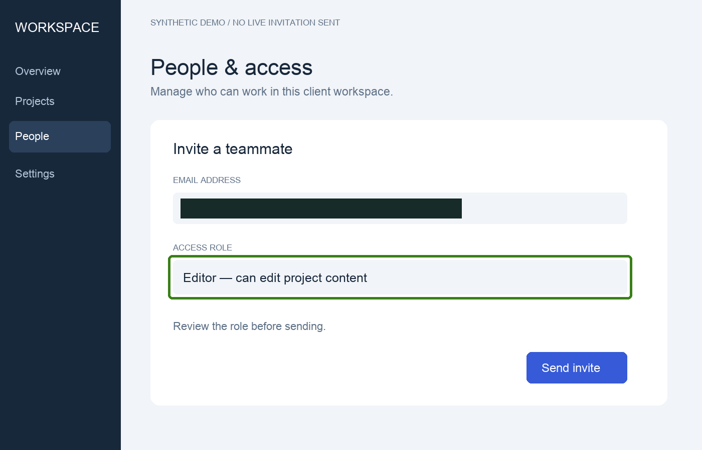

# Guide Capture

**Turn your walkthrough screenshots into a client-ready guide.**

For consultants, customer-success teams and trainers handing a workflow to someone else. Package ordered screenshots with clear actions, observed outcomes and baked-in redactions.



**Demo:** help a client review a workspace invitation. [Read the generated guide](examples/workspace-onboarding/output/guide.md), or [inspect the input and screenshots](examples/workspace-onboarding/README.md). The demo UI is fictional and synthetic; no live invitation was sent.

## Try the example

```sh
git clone https://github.com/IFFiend/guide-capture.git
cd guide-capture
python3 -m venv .venv
.venv/bin/python -m pip install -r requirements.txt
.venv/bin/python scripts/guide.py examples/workspace-onboarding/input.json --out output/client-guide
```

Open `output/client-guide/index.html` or `guide.md`. The folder includes its own images, so you can move it without depending on this repository. Python 3.10+; Windows uses `.venv\Scripts\python.exe`.

## Document your workflow

Capture one screenshot per meaningful step, using a demo account where possible. In [input.json](examples/workspace-onboarding/input.json), describe the action, expected outcome and what was actually visible. Specify redaction and highlight rectangles in screenshot pixels. The builder copies only the processed images, not the originals.

| You supply | The guide preserves |
| --- | --- |
| Audience and prerequisites | Who it is for and where to start |
| Ordered screenshots and actions | A step-by-step guide with local images |
| Observed outcomes and origin | What was seen, supplied or only simulated |
| Marked private areas | Opaque redactions in exported image pixels |

Read the [evidence and privacy contract](references/evidence-and-privacy.md). Redaction is manual; the tool does not find private information in images or prose automatically. Review both before sharing.

## Use as a skill

The root [SKILL.md](SKILL.md) tells an agent how to gather authorized evidence and create the guide. Clone the whole repository into its supported skill directory:

```sh
git clone https://github.com/IFFiend/guide-capture.git ~/.agents/skills/guide-capture
```

> Use $guide-capture to turn these screenshots into an onboarding guide for a client administrator. Label supplied evidence, mask the marked email addresses and report missing steps instead of inventing them.

## What is checked

Required step fields, unique IDs, annotation bounds, provenance labels and image export. The builder assembles evidence; it does **not** record the screen, verify live actions or automatically export PDF. An expected outcome is not an observed result. The sample explicitly labels its synthetic origin.

Experimental v0.1. Use the **Use report** issue form to describe whether the recipient could follow the guide and what you edited. Run `python -m unittest discover -s tests -v` for the local checks.

## License

[PolyForm Noncommercial 1.0.0](LICENSE).

## 中文

面向顾问、客服和培训人员：把操作截图整理成可交付的图文指南。示例是客户工作区邀请流程，与活动海报无关；可以直接阅读生成的 Markdown。截图、实际观察和模拟状态会明确区分。使用权限以 LICENSE 为准。
