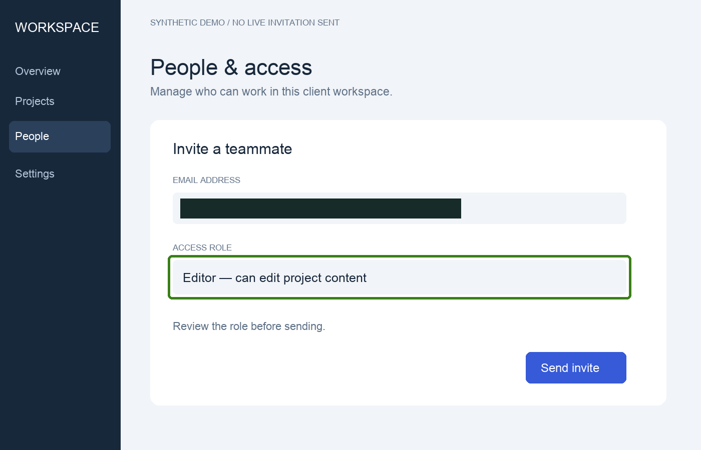

# Client workspace onboarding

Audience: consultants and customer-success teams handing an access-management workflow to a client administrator.

[Brief](request.md) · [Input](input.json) · [Original synthetic screenshots](screenshots) · [Complete generated guide](output/guide.md) · [Technical report](output/report.json)



The three distinct states show the member list, an invitation draft, and a pending invitation. Pending is not accepted. All UI and addresses are fictional, and no live action was performed.

Run from the repository root:

```sh
python scripts/guide.py examples/workspace-onboarding/input.json --out output/my-client-guide
```

The result includes portable HTML, Markdown and processed images. Original images are not copied to output. Review all prose and pixels for private information before sharing.
