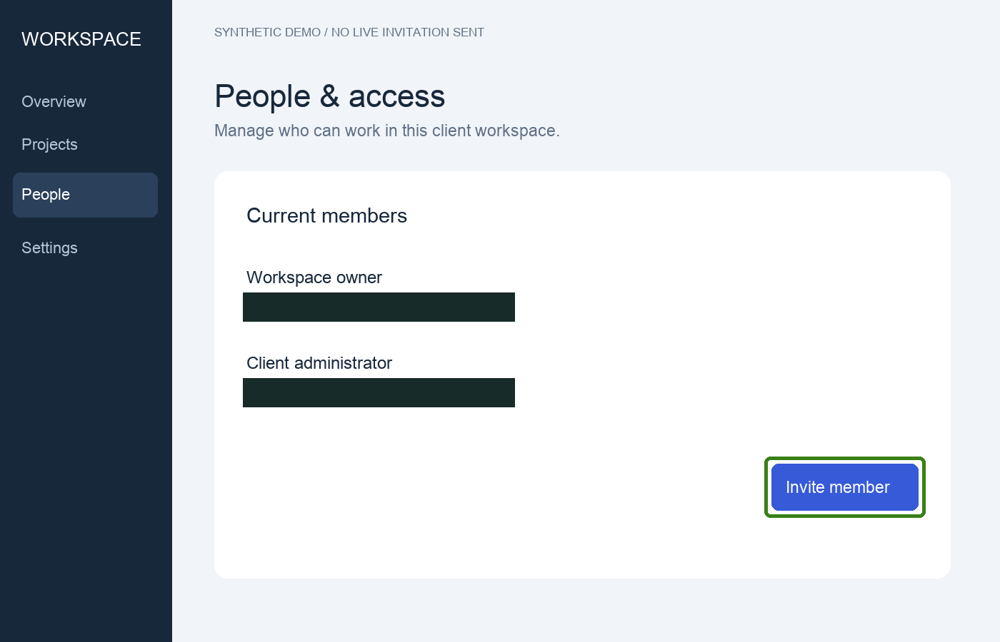
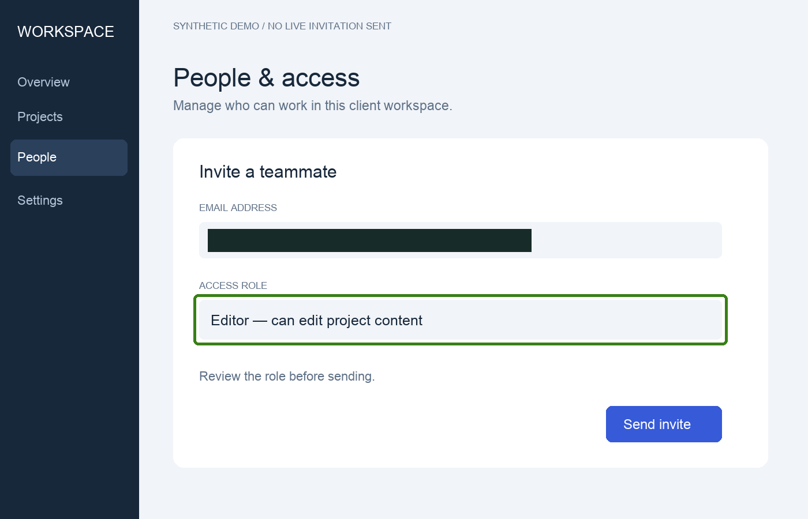
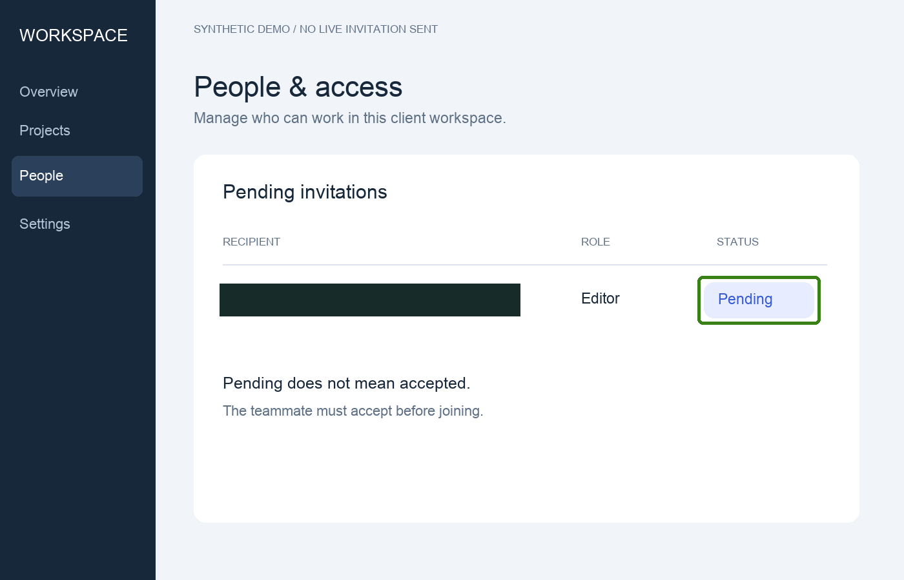

# Invite a teammate to your client workspace

A client administrator receiving a consultant handover.

## Before you start

Use a workspace where you are authorized to manage members. This example uses a fictional UI; labels may differ in your actual product.

## 1. Open People in workspace settings

Expected: The member list and Invite member action are visible.

Observed: The synthetic screenshot shows two current members and an invitation button.

Evidence: synthetic-demo

## 2. Enter the recipient and review the Editor role

Expected: The intended email and access role are set before the invitation is sent.

Observed: The synthetic draft has an email value and the Editor role selected; it is not yet sent.

Evidence: synthetic-demo

## 3. Send the invitation and check its pending status

Expected: The intended recipient appears with the Editor role and a Pending status.

Observed: The synthetic final state shows Editor and Pending. It does not establish acceptance or actual delivery.

Evidence: synthetic-demo

